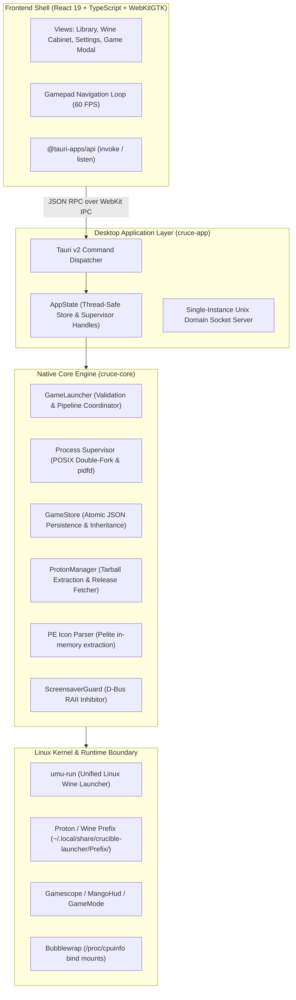

# Cruce Architecture & Systems Reference

This document outlines the technical design, subsystem boundaries, concurrency model, and execution pipeline of Cruce.

---

## 1. System Overview

Cruce is structured as a multi-tier native application consisting of a headless systems engine (`cruce-core`), a desktop application bridge (`cruce-app`), and a hardware-accelerated presentation shell (`ui`).



---

## 2. Workspace & Crate Boundaries

```
cruce/
├── crates/
│   ├── cruce-core/        # Pure Rust library; zero GUI dependencies.
│   │   └── src/
│   │       ├── types.rs             # Serializable configuration schemas (GameConfig, GlobalConfigData)
│   │       ├── paths.rs             # XDG standard directory resolution & path canonicalization
│   │       ├── config.rs            # Two-tier configuration inheritance engine
│   │       ├── game_store.rs        # In-memory thread-safe game repository with atomic disk sync
│   │       ├── launcher.rs          # 3-stage launch pipeline coordinator
│   │       ├── command_builder.rs   # Recursive command wrapper hierarchy
│   │       ├── env_builder.rs       # Environment sanitization and variable injection
│   │       ├── process.rs           # POSIX double-fork detachment & /proc environ scanner
│   │       ├── state_tracker.rs     # Lock-free game lifecycle state machine
│   │       ├── screensaver.rs       # D-Bus org.freedesktop.ScreenSaver RAII inhibitor
│   │       ├── gamescope.rs         # Micro-compositor CLI parameter generation
│   │       ├── dll_overrides.rs     # WINEDLLOVERRIDES alias resolver and bucket sorter
│   │       ├── fingerprint.rs       # Bubblewrap anti-tamper hardware snapshot manager
│   │       ├── proton_manager.rs    # Runner archive extractor and GitHub API client
│   │       ├── pe_icon.rs           # Windows PE32/PE32+ resource section parser
│   │       ├── steam_api.rs         # Steam AppID matching & heuristic search
│   │       ├── artwork.rs           # Steam CDN artwork downloader and cache
│   │       ├── save_manager.rs      # Prefix save directory backup & zip restoration
│   │       ├── zip_archive.rs       # Zip-Slip defended archive extractor
│   │       ├── wine_tools.rs        # Prefix-scoped Wine maintenance tool launcher
│   │       └── desktop_shortcuts.rs # FreeDesktop .desktop generation and mime registration
│   │
│   └── cruce-app/         # Tauri v2 desktop application & IPC command surface
│       └── src/
│           ├── main.rs              # App entrypoint, single-instance socket server, argument parser
│           ├── commands.rs          # Typed Tauri IPC command handlers
│           ├── state.rs             # Global AppState holder with RwLock synchronization
│           └── models.rs            # Frontend view-model serialization adapters
│
└── ui/                    # React 19 + TypeScript + Tailwind CSS v4 presentation layer
    └── src/
        ├── components/      # UI components (Library, Modals, Wine Cabinet, Settings)
        ├── lib/             # Typed Tauri IPC bridges, data formatters, gamepad loop
        └── main.tsx         # Application root mount
```

---

## 3. Core Engine Mechanics

### 3.1. Process Supervision & Detached Double-Fork
When launching a game under Linux desktop environments (e.g., KDE Plasma, GNOME Wayland), launching via standard `std::process::Command` causes window managers to group the running game under the launcher's process tree and taskbar identity.

To solve this, `cruce-core::process::detached_fork` executes a true POSIX double-fork:
1. **Pipe Allocation**: An inter-process pipe is created between parent and child.
2. **First Fork**: The initial child calls `setsid()` to create a new session and detach from the controlling terminal.
3. **Second Fork**: The grandchild process is spawned. Standard input is redirected to `/dev/null`, and standard output/error are redirected to timestamped log files in `~/.local/share/crucible-launcher/logs/games/<game>/`.
4. **Grandchild PID Transmission**: The middle child writes the grandchild's PID into the pipe and exits immediately (`_exit(0)`).
5. **Reparenting**: The grandchild is reparented to `systemd` (PID 1), breaking desktop environment window grouping.

### 3.2. Lifecycle State Machine
Game execution states are tracked through an atomic finite state machine (`GameStateTracker`):

$$\text{Idle} \xrightarrow{\text{validate}} \text{Launching} \xrightarrow{\text{spawn}} \text{Running} \xrightarrow{\text{stop / exit}} \text{Stopping} \rightarrow \text{Idle}$$

* Validated state transitions prevent race conditions (e.g., double-launching an active title).
* A background supervisor thread monitors process liveness using Linux `pidfd_open` when supported, or falls back to polling `/proc/<pid>` without allocation.

### 3.3. D-Bus Screensaver Invalidation Guard
Games must prevent the display server from entering sleep modes or activating screensavers during controller gameplay:
* Cruce acquires an inhibit lock on `org.freedesktop.ScreenSaver` via `zbus`.
* The resulting `ScreensaverGuard` implements the **RAII (Resource Acquisition Is Initialization)** pattern. If the game process exits, the launcher is terminated, or a thread panics, the guard's `Drop` implementation automatically sends the D-Bus `Uninhibit` call.

---

## 4. Launch Pipeline & Command Construction

Games are executed through a nested wrapper hierarchy defined in `command_builder.rs`:

```
[gamescope] ➔ [systemd-run] ➔ [mangohud] ➔ [gamemoderun] ➔ [wrapper] ➔ [bwrap] ➔ [umu-run] ➔ [game.exe] ➔ [args]
```

1. **Gamescope**: Configures output resolutions, upscaling methods (FSR, NIS, Integer), and frame rate limits.
2. **systemd-run**: Optionally places the game in a dedicated systemd transient cgroup scope (`cruce-game-<uuid>.scope`) for clean memory and CPU scheduling.
3. **MangoHud & GameMode**: Injected when enabled in per-game or global settings.
4. **Bubblewrap (`bwrap`)**: Bind-mounts `/proc/cpuinfo` and `/proc/version` snapshots from `~/.local/share/crucible-launcher/fingerprints/<game>/` to prevent Denuvo anti-tamper token resets across kernel updates.
5. **umu-run**: Resolves the target Proton distribution, initializes the prefix, configures DXVK/VKD3D, and invokes the game binary.

---

## 5. Security & Archive Defense

Third-party game mods, patches, and runner tarballs represent untrusted I/O boundaries. `cruce-core` enforces strict file extraction security:

* **Zip-Slip Path Traversal Protection**: Every file path inside a `.zip` archive is canonicalized and validated using `strip_prefix`. Any entry containing `../` sequences or attempting to escape the target directory is rejected with `CruceError::ZipSlip`.
* **Tarball Symlink & Hardlink Guards**: When extracting runner archives (`tar.xz` / `tar.gz`), symlinks and hardlinks targeting paths outside the extraction root are discarded to prevent arbitrary file overwrites.
* **Decompression Limits**: Maximum file count (50,000 entries) and uncompressed size ceilings (20 GB) prevent decompression bomb exploits.

---

## 6. Storage & Compatibility Architecture

Cruce is designed for **100% drop-in parity** with existing Crucible installations. All state is stored in standard XDG user paths:

| Path | Purpose | Format |
| :--- | :--- | :--- |
| `~/.local/share/crucible-launcher/games/<name>.json` | Per-game configuration and playtime metrics | Atomic JSON write via temporary file replace |
| `~/.local/share/crucible-launcher/global_config.json` | Global defaults inherited by all games | Atomic JSON write |
| `~/.local/share/crucible-launcher/Prefix/<name>prefix/` | Wine prefix (drive_c, registry, dosdevices) | Standard Wine prefix directory tree |
| `~/.local/share/crucible-launcher/backups/<name>_<timestamp>.zip` | Wine save game snapshots | Compressed zip archive |
| `~/.local/share/crucible-launcher/artwork/exe_<sha1>/` | Cached Steam artwork (portrait, hero, header) | Standard JPEG / PNG image files |
| `~/.local/share/applications/crucible-<name>.desktop` | Desktop entries for system menus | Freedesktop `.desktop` standard |

### Two-Tier Configuration Inheritance
Per-game configurations inherit fallback values from `global_config.json`. Inheritable keys include:
* Proton runner selection
* Launch arguments & custom DLL overrides
* Environment variable tables
* Gamescope configuration parameters
* MangoHud and GameMode activation flags

A game only persists overrides when explicitly configured; unconfigured keys fall back dynamically to global defaults.
